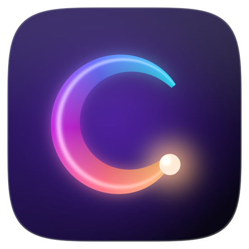
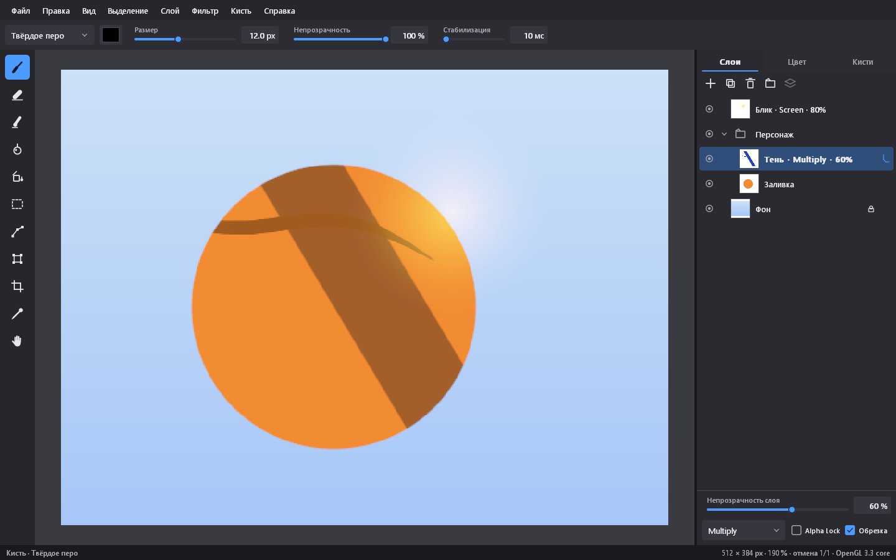
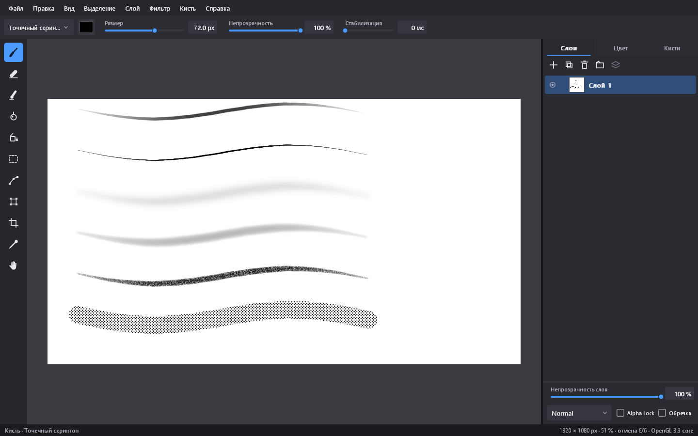
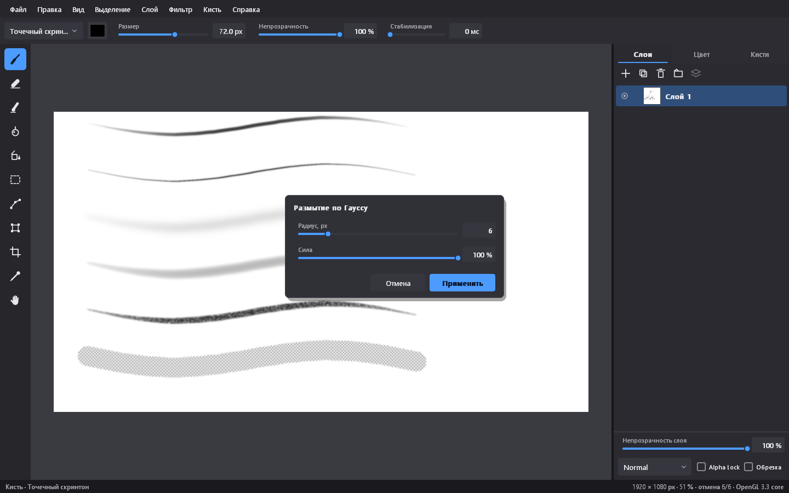

<p align="center">
  
</p>

<h1 align="center">ChromaStudio</h1>

<p align="center">
  <b>An offline painting editor for Windows with a GPU brush engine written from scratch in C++20.</b><br>
  Pressure-sensitive pens, wet media, layers with 27 blend modes, filters, editable vector line art — no network, no telemetry, no dependencies.
</p>

<p align="center">
  <a href="LICENSE"></a>
  
  
  
  
</p>

<p align="center"><a href="README.ru.md">Читать по-русски</a></p>

<p align="center">
  
</p>

## Highlights

- **Pen first.** Windows Ink pressure and tilt through `WM_POINTER`, a time-based stabiliser (EMA or window), pressure curves and speed-aware tapering. Pens grow from a point at the start of a stroke; the first and last segments are drawn, not dropped. Lines thinner than a pixel stay whole and get lighter instead of breaking into dots, at any zoom.
- **Seven built-in brushes:** hard pen, soft pen, fountain pen (tilt), airbrush, watercolour, grain brush, dot screentone — plus smudge and blur tools.
- **Wet media.** Watercolour carries pigment from the surface stamp by stamp; smudge has a reservoir; both work across tile seams.
- **Layers.** 27 blend modes, groups, clipping to the base, Alpha Lock, opacity, visibility and locks, drag-and-drop reordering.
- **Selection.** Lasso, magic wand with tolerance, fill, move, crop, clipboard as PNG and DIBV5.
- **Filters with live preview:** Gaussian blur, tone curves, unsharp mask, chromatic aberration, anime line extraction.
- **Editable vector line art:** strokes stay Bézier knots with width per knot; insert, drag handles, delete, rasterize.
- **Your work is safe.** `.rawproj` is ZIP64 with CRC-checked atomic saving; a recovery journal is written every 30 s, so a crash costs at most half a minute.
- **Exchange.** PNG/JPEG import as a layer (EXIF orientation, embedded ICC → sRGB), PNG export with exact alpha, JPEG export over white, drag files onto the window.
- **Brush import.** Own JSON profiles, PresetFormat v1 (as JSON, Base64, `data:` URI or a link with the preset inside), and IPBZ records (name and size).
- **Offline by design.** No networking code at all; a release test checks that the executable imports no networking library.

<table>
  <tr>
    <td></td>
    <td></td>
  </tr>
  <tr>
    <td align="center">Built-in brushes, from soft pen to screentone</td>
    <td align="center">Filters preview on the canvas before you apply them</td>
  </tr>
</table>

## Install

1. Download `ChromaStudio-0.1.0-win64.zip` from [Releases](https://github.com/Haise511/ChromaStudio/releases).
2. Unzip it and run `install.cmd`: it installs for the current user into `%LOCALAPPDATA%\Programs\ChromaStudio`, adds a Start menu shortcut and opens `.rawproj` files — no administrator rights. Or just run `ChromaStudio.exe` from the folder.

Requirements: Windows 10 version 2004 or Windows 11, x64, a GPU with OpenGL 3.3. A pen tablet is optional; mouse and keyboard work everywhere. The interface is in Russian for now.

## Build from source

You need Visual Studio 2022 with the "Desktop development with C++" workload (it brings CMake ≥ 3.25). There is nothing to download: ZIP64, DEFLATE, JSON, CRC-32 and the OpenGL loader are part of the project.

```powershell
cmake -S . -B build -G "Visual Studio 17 2022" -A x64 -DCHROMA_WARNINGS_AS_ERRORS=ON
cmake --build build --config Release
ctest --test-dir build -C Release --output-on-failure
```

`cmake --build build --config Release --target package_zip` makes the installable ZIP. `chroma_bench` reproduces the performance measurement below.

## Shortcuts

| Keys | Action | Keys | Action |
|---|---|---|---|
| `B` `E` `S` `U` | brush, eraser, smudge, blur | `1` … `7` | built-in brushes |
| `I` | colour picker | `Space` | hand (pan) |
| `M` | lasso / magic wand (tap) | `G` | fill |
| `Ctrl+T` | move layer or selection | `V` | edit vector knots |
| `F6` | brush catalogue | `Ctrl+Shift+N` | new layer |
| `Alt+↑` `Alt+↓` | move layer up / down | `F10` | menu from the keyboard |
| `Ctrl+Z` `Ctrl+Y` | undo / redo | `Ctrl+S` `Ctrl+Shift+E` | save / export |

## Performance

Measured with `chroma_bench` on an Intel Core i5-12400F and an RTX 3060: a 4096 × 4096 canvas, 12 layers with a quarter of their tiles painted, a 1440 × 900 window, 240 Hz pen input, 60 Hz output, a 64 px pen.

| p95 | whole canvas in view | 100 % zoom | budget |
|---|---:|---:|---:|
| CPU frame preparation | 2.4 ms | 0.4 ms | 4 ms |
| GPU frame time | 6.9 ms | 5.2 ms | 12 ms |
| pen packet → frame on screen | 24.1 ms | 21.7 ms | 33 ms |

Full numbers, including p99 and start-up times, are in [docs/measurements-2026-11-20.md](docs/measurements-2026-11-20.md).

## How it works

| Module | What it does |
|---|---|
| `src/core` | Window-free C++: stroke geometry and stabiliser, brush profiles, layer tree, CPU reference compositor, selection, raster operations, filters' parameters, vector knots, tile history. |
| `src/render_gl` | OpenGL 3.3 core through WGL with its own loader: stamp, wet, composite and filter programs, 128 px tiles in RGBA16F. |
| `src/project_io` | `.rawproj` (ZIP64 + JSON + binary16 tiles), recovery journal, PNG/JPEG via WIC, assets by SHA-256, brush import. |
| `src/ui` | The interface drawn on the GPU: SDF shapes, cached GDI text, layout in DIP, menus, docks, brush previews made by the real engine. |
| `src/*.cpp` | The Win32 shell: Per-Monitor V2 window, pointer input with capture, dialogs, clipboard, the editor itself. |

Pixels are sRGB values with premultiplied alpha, half-float, in sparse 128 × 128 tiles, blended as they are — the way painting editors blend, so 50 % black over white is 128, exactly as in ibisPaint. Projects saved by version 0.1.0 (linear light) open converted and are saved as a new file. The RAM copy of every tile is canonical and the GPU holds a cache, so a lost graphics device costs only the stroke in progress. History stores immutable tile versions that commands share, so undo is a pointer swap. The GPU compositor is checked against the CPU reference for all 27 blend modes to 0.002 per channel.

Comments in the code cite sections (§) of the internal engine specification, which is not published.

## Tests

110 test cases in five CTest suites: `core` (geometry, compositor goldens, layers, selection, filters, vectors), `io` (ZIP64, JSON, projects, journal, PNG/JPEG, brush import), `gpu` (GPU/CPU parity, wet media, filters, interface snapshots; skipped without OpenGL 3.3), `ui` (layout at 96 and 144 DPI, keyboard, docks) and `release` (no networking imports, Per-Monitor V2 manifest). The last manual acceptance run with a synthetic pen is in [docs/acceptance-2026-11-20.md](docs/acceptance-2026-11-20.md).

## Brush textures

The repository ships no bitmap textures: the built-in brushes are procedural. To use your own tip or grain images, put PNG files into `assets/textures/` and JPEG papers into `assets/materials/` (or into `%LOCALAPPDATA%\ChromaStudio\brushes\assets`). Profiles refer to them by SHA-256 or by file name — see [assets/README.md](assets/README.md).

## Roadmap

- English interface.
- Painting without a GPU (today the CPU fallback shows the paper only).
- A 256 MiB GPU tile budget with LRU eviction and history spooled to disk.
- Scale and rotate in the transform tool; the layer manager window.
- Imported brushes' own blend modes; embedding custom textures into projects.

## Contributing

Issues and pull requests are welcome — see [CONTRIBUTING.md](CONTRIBUTING.md).

## License

[MIT](LICENSE) © 2026 Haise511 and ChromaStudio contributors.
