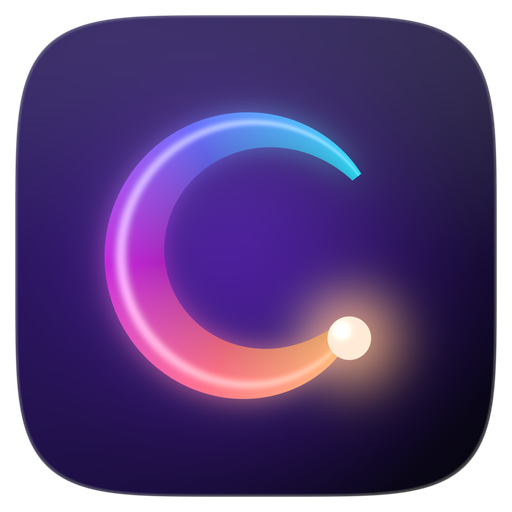
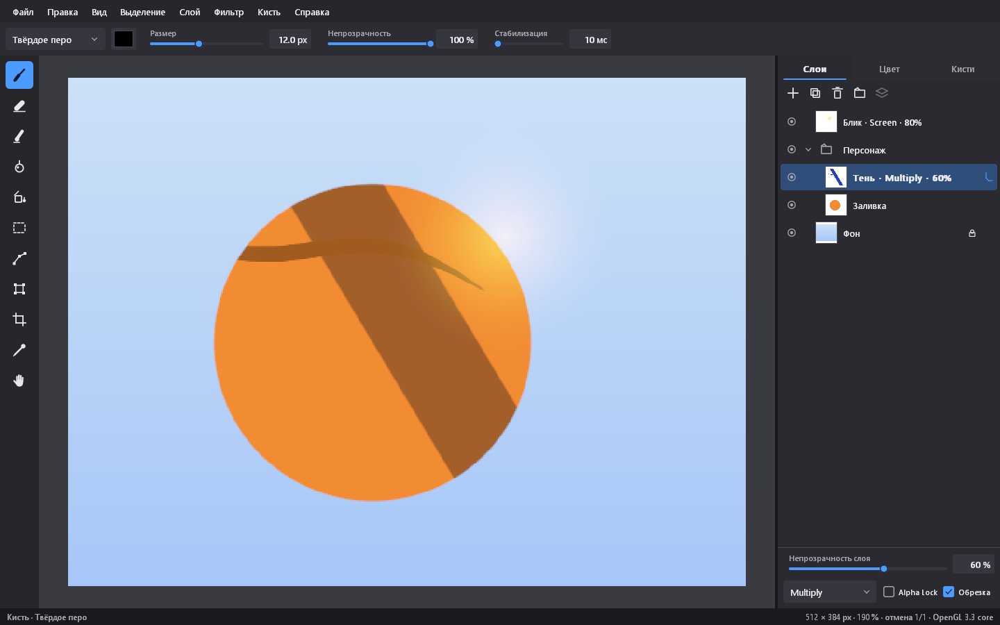
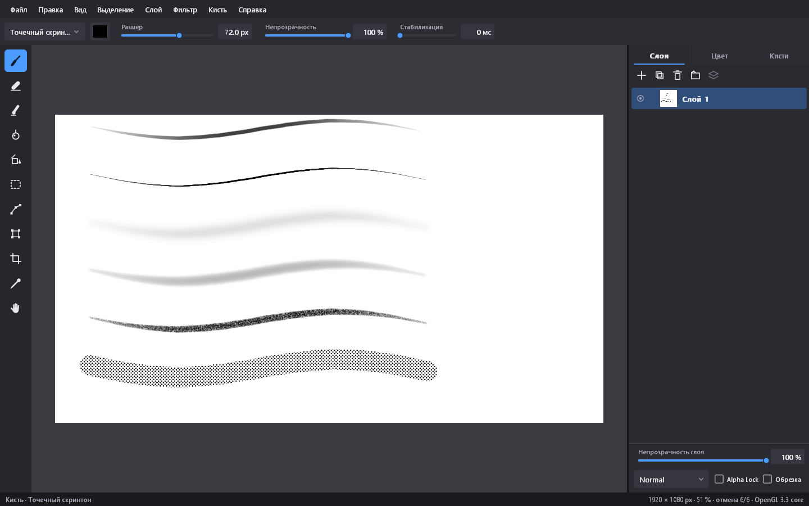
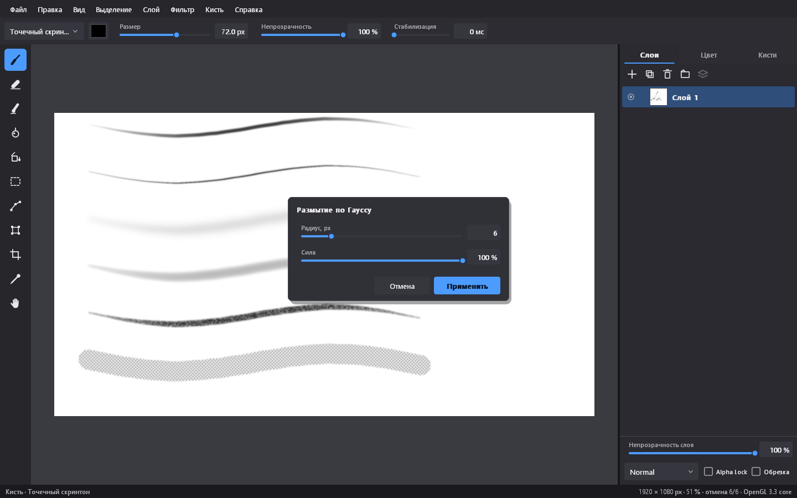

<p align="center">
  
</p>

<h1 align="center">ChromaStudio</h1>

<p align="center">
  <b>Автономный графический редактор для Windows с GPU-движком кистей, написанным с нуля на C++20.</b><br>
  Перо с нажимом, мокрые материалы, слои с 27 режимами наложения, фильтры, редактируемый векторный лайнарт — без сети, без телеметрии, без зависимостей.
</p>

<p align="center">
  <a href="LICENSE"></a>
  
  
  
  
</p>

<p align="center"><a href="README.md">English version</a></p>

<p align="center">
  
</p>

## Возможности

- **Перо прежде всего.** Нажим и наклон Windows Ink через `WM_POINTER`, стабилизация по времени (EMA или окно), кривые нажима и сужение концов с учётом скорости. Перья начинают штрих с точки; первый и последний отрезки рисуются, а не теряются. Линии тоньше пикселя не рассыпаются на точки, а становятся светлее — при любом масштабе.
- **Семь встроенных кистей:** твёрдое перо, мягкое перо, перьевая ручка (с наклоном), аэрограф, акварель, зернистая кисть, точечный скринтон — а также палец и размытие.
- **Мокрые материалы.** Акварель переносит пигмент с поверхности оттиск за оттиском, у пальца есть резервуар; всё работает через стыки тайлов.
- **Слои.** 27 режимов наложения, группы, обрезка по основе, Alpha Lock, непрозрачность, видимость и замки, перетаскивание в списке.
- **Выделение.** Лассо, волшебная палочка с допуском, заливка, перемещение, кадрирование, буфер обмена в PNG и DIBV5.
- **Фильтры с живым превью:** размытие по Гауссу, кривые, нерезкая маска, хроматическая аберрация, извлечение линий в стиле аниме.
- **Редактируемый векторный лайнарт:** штрих остаётся узлами Безье с толщиной в каждом узле; вставка, ручки, удаление, растеризация.
- **Работа не потеряется.** `.rawproj` — ZIP64 с атомарным сохранением и проверкой CRC; журнал восстановления пишется каждые 30 секунд, так что сбой стоит не больше полуминуты.
- **Обмен файлами.** Импорт PNG/JPEG как слоя (поворот по EXIF, встроенный ICC → sRGB), экспорт PNG с точной альфой, JPEG на белом фоне, перетаскивание файлов в окно.
- **Импорт кистей.** Собственные JSON-профили, PresetFormat v1 (как JSON, Base64, `data:` URI или ссылка с пресетом внутри) и записи IPBZ (имя и размер).
- **Автономность по замыслу.** В программе нет сетевого кода; тест выпуска проверяет, что EXE не импортирует ни одной сетевой библиотеки.

<table>
  <tr>
    <td></td>
    <td></td>
  </tr>
  <tr>
    <td align="center">Встроенные кисти — от мягкого пера до скринтона</td>
    <td align="center">Фильтр виден на холсте до применения</td>
  </tr>
</table>

## Установка

1. Скачайте `ChromaStudio-0.1.0-win64.zip` в разделе [Releases](https://github.com/Haise511/ChromaStudio/releases).
2. Распакуйте и запустите `install.cmd`: программа установится для текущего пользователя в `%LOCALAPPDATA%\Programs\ChromaStudio`, появится ярлык в меню «Пуск», файлы `.rawproj` будут открываться в ChromaStudio. Права администратора не нужны. Можно и просто запустить `ChromaStudio.exe` из папки.

Требования: Windows 10 версии 2004 или Windows 11, x64, видеокарта с OpenGL 3.3. Планшет с пером — по желанию: всё доступно мышью и клавиатурой.

## Сборка из исходников

Нужна Visual Studio 2022 с нагрузкой «Разработка классических приложений на C++» (CMake ≥ 3.25 входит в неё). Скачивать ничего не нужно: ZIP64, DEFLATE, JSON, CRC-32 и загрузчик OpenGL — часть проекта.

```powershell
cmake -S . -B build -G "Visual Studio 17 2022" -A x64 -DCHROMA_WARNINGS_AS_ERRORS=ON
cmake --build build --config Release
ctest --test-dir build -C Release --output-on-failure
```

`cmake --build build --config Release --target package_zip` собирает установочный ZIP, `chroma_bench` повторяет замер производительности из раздела ниже.

## Клавиши

| Клавиши | Действие | Клавиши | Действие |
|---|---|---|---|
| `B` `E` `S` `U` | кисть, ластик, палец, размытие | `1` … `7` | встроенные кисти |
| `I` | пипетка | `Пробел` | рука (сдвиг вида) |
| `M` | лассо / волшебная палочка (касание) | `G` | заливка |
| `Ctrl+T` | перемещение слоя или выделения | `V` | правка векторных узлов |
| `F6` | каталог кистей | `Ctrl+Shift+N` | новый слой |
| `Alt+↑` `Alt+↓` | слой выше / ниже | `F10` | меню с клавиатуры |
| `Ctrl+Z` `Ctrl+Y` | отменить / повторить | `Ctrl+S` `Ctrl+Shift+E` | сохранить / экспорт |

## Производительность

Замер `chroma_bench` на Intel Core i5-12400F и RTX 3060: холст 4096 × 4096, 12 слоёв, на каждом закрашена четверть тайлов, окно 1440 × 900, ввод пера 240 Гц, вывод 60 Гц, перо 64 px.

| p95 | холст целиком | масштаб 100 % | бюджет |
|---|---:|---:|---:|
| подготовка кадра на CPU | 2,4 мс | 0,4 мс | 4 мс |
| кадр на GPU | 6,9 мс | 5,2 мс | 12 мс |
| пакет пера → кадр на экране | 24,1 мс | 21,7 мс | 33 мс |

Полные цифры, включая p99 и время запуска, — в [docs/measurements-2026-11-20.md](docs/measurements-2026-11-20.md).

## Как это устроено

| Модуль | Что делает |
|---|---|
| `src/core` | C++ без окон: геометрия штриха и стабилизация, профили кистей, дерево слоёв, эталонный композитор на CPU, выделение, растровые операции, параметры фильтров, векторные узлы, история тайлов. |
| `src/render_gl` | OpenGL 3.3 core через WGL со своим загрузчиком: программы оттиска, мокрого прохода, композиции и фильтров, тайлы 128 px в RGBA16F. |
| `src/project_io` | `.rawproj` (ZIP64 + JSON + тайлы binary16), журнал восстановления, PNG/JPEG через WIC, ресурсы по SHA-256, импорт кистей. |
| `src/ui` | Интерфейс, нарисованный на GPU: SDF-фигуры, кеш GDI-текста, раскладка в DIP, меню, доки, превью кистей самим движком. |
| `src/*.cpp` | Оболочка Win32: окно Per-Monitor V2, ввод указателя с захватом, диалоги, буфер обмена, сам редактор. |

Пиксели хранятся как значения sRGB с предумноженной альфой, в half-float, в разреженных тайлах 128 × 128, и смешиваются как есть — так, как это делают программы для рисования: 50 % чёрного на белом дают 128, ровно как в ibisPaint. Проекты версии 0.1.0 (линейный свет) открываются с переводом и сохраняются новым файлом. Каноническая копия каждого тайла — в RAM, на GPU — кеш, поэтому потеря видеоустройства стоит только незаконченного штриха. История хранит неизменяемые версии тайлов, общие для команд, поэтому отмена — это перестановка ссылок. GPU-композитор сверяется с эталоном на CPU во всех 27 режимах с допуском 0,002 на канал.

Комментарии в коде ссылаются на разделы (§) внутренней спецификации движка, она не публикуется.

## Тесты

110 тестов в пяти наборах CTest: `core` (геометрия, эталоны композитора, слои, выделение, фильтры, вектор), `io` (ZIP64, JSON, проекты, журнал, PNG/JPEG, импорт кистей), `gpu` (паритет GPU/CPU, мокрые материалы, фильтры, снимки интерфейса; пропускается без OpenGL 3.3), `ui` (раскладка при 96 и 144 DPI, клавиатура, доки) и `release` (нет сетевых импортов, манифест Per-Monitor V2). Протокол последней ручной приёмки синтетическим пером — в [docs/acceptance-2026-11-20.md](docs/acceptance-2026-11-20.md).

## Текстуры кистей

В репозитории нет растровых текстур: встроенные кисти процедурные. Чтобы использовать свои изображения кончика или зерна, положите PNG в `assets/textures/`, а JPEG-бумагу в `assets/materials/` (или в `%LOCALAPPDATA%\ChromaStudio\brushes\assets`). Профили ссылаются на них по SHA-256 или по имени файла — подробнее в [assets/README.md](assets/README.md).

## Планы

- Английский интерфейс.
- Рисование без GPU (сейчас запасной CPU-режим показывает только бумагу).
- Бюджет GPU-тайлов 256 MiB с вытеснением по LRU и выгрузка истории на диск.
- Масштаб и поворот в трансформации, окно менеджера слоёв.
- Собственные режимы наложения импортированных кистей, встраивание текстур в проект.

## Участие

Issues и pull requests приветствуются — см. [CONTRIBUTING.md](CONTRIBUTING.md).

## Лицензия

[MIT](LICENSE) © 2026 Haise511 и участники ChromaStudio.
